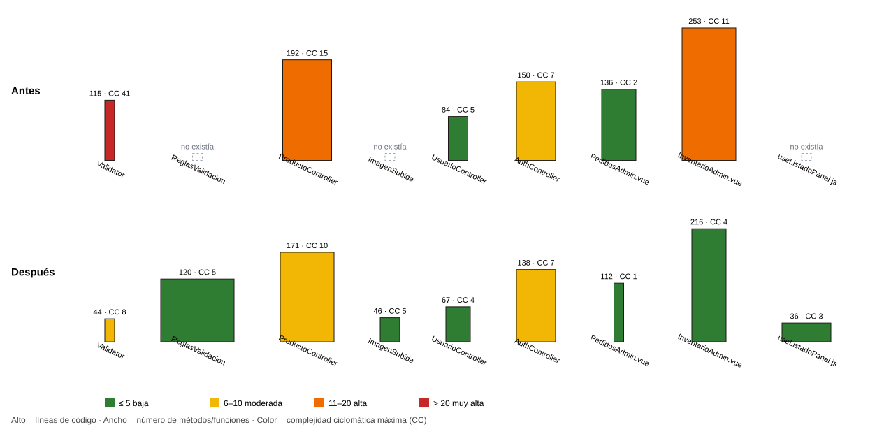

# Métricas del software — MyA FOOTWEAR STORE

Métricas de producto obtenidas del código fuente antes y después de la refactorización. Las dos mediciones usan las mismas herramientas, versiones, configuración y alcance (ver [EVALUACION_SOFTWARE.md](EVALUACION_SOFTWARE.md)):

| Medición | Commit | Evidencias |
|---|---|---|
| Antes | `ef4486a`: proyecto completo, antes de refactorizar | [`evidencias/antes/`](evidencias/antes/) |
| Después | `4382a5a`: después de las 6 refactorizaciones y los ajustes de estándares | [`evidencias/despues/`](evidencias/despues/) |

## 1. Métricas iniciales

| Métrica | Valor |
|---|---|
| Líneas de código (sin comentarios ni líneas en blanco) | 13 361 |
| Archivos de código fuente | 106 |
| Complejidad ciclomática PHP | 230 métodos · total 643 · promedio 2,80 · máxima 41 (`Validator::aplicarRegla`) · 5 métodos con CC > 10 |
| Complejidad ciclomática JS/Vue | 413 funciones · total 911 · promedio 2,21 · máxima 15 (`CuponesAdmin.validar`, `ProductoEditor.validarFormulario`) · 5 funciones con CC > 10 |
| Duplicidad | 1,27 %: 206 líneas duplicadas de 16 280 analizadas, 23 bloques |
| Problemas de calidad | 25 |
| Problemas de diseño | 26 |
| Incumplimiento de estándares | 86 |
| Posibles vulnerabilidades | 0 en producción · 5 moderadas en desarrollo · 6 operadores `@` |
| Deuda técnica estimada | 25,2 h |

Los 5 métodos PHP más complejos antes de refactorizar:

| Método | CC |
|---|---|
| `Validator::aplicarRegla` | **41** |
| `ProductoController::subirImagen` | 15 |
| `Validator::validar` | 12 |
| `Pedido::cotizar` | 12 |
| `Cupon::motivoInvalido` | 11 |

## 2. Métricas posteriores a la refactorización

| Métrica | Valor |
|---|---|
| Líneas de código | 13 328 |
| Archivos de código fuente | 112 |
| Complejidad ciclomática PHP | 253 métodos · total 627 · promedio 2,48 · máxima 12 (`Pedido::cotizar`) · 2 métodos con CC > 10 |
| Complejidad ciclomática JS/Vue | 398 funciones · total 884 · promedio 2,22 · máxima 15 · 3 funciones con CC > 10 |
| Duplicidad | 1,06 %: 174 líneas duplicadas de 16 350, 20 bloques |
| Problemas de calidad | 20 |
| Problemas de diseño | 18 |
| Incumplimiento de estándares | 72 |
| Posibles vulnerabilidades | 0 en producción · 5 moderadas en desarrollo · 6 operadores `@` |
| Deuda técnica estimada | 18,3 h |

## 3. Tabla comparativa de resultados

| Métrica o indicador | Antes | Después | Variación |
|---|---|---|---|
| Líneas de código | 13 361 | 13 328 | **−33** (−0,2 %) |
| Cantidad de archivos | 106 | 112 | **+6** |
| Complejidad ciclomática máxima (PHP) | 41 | 12 | **−29** (−70,7 %) |
| Complejidad ciclomática promedio (PHP) | 2,80 | 2,48 | **−0,32** (−11,4 %) |
| Métodos PHP con CC > 10 | 5 | 2 | **−3** |
| Complejidad ciclomática promedio (JS/Vue) | 2,21 | 2,22 | +0,01 |
| Funciones JS/Vue con CC > 10 | 5 | 3 | **−2** |
| Porcentaje de duplicidad | 1,27 % | 1,06 % | **−0,21 puntos** (−32 líneas, −3 bloques) |
| Duplicidad solo en PHP | 0,47 % | 0,23 % | **−51 %** |
| Duplicidad solo en JavaScript | 0,82 % | 0,19 % | **−77 %** |
| Problemas de calidad | 25 | 20 | **−5** (−20 %) |
| Problemas de diseño | 26 | 18 | **−8** (−30,8 %) |
| Incumplimiento de estándares | 86 | 72 | **−14** (−16,3 %) |
| Errores de PHPStan | 2 | 0 | **−2** |
| Errores de PSR-12 (PHP_CodeSniffer) | 2 | 0 | **−2** |
| Errores de ESLint | 1 | 0 | **−1** |
| Posibles vulnerabilidades (producción) | 0 | 0 | 0 |
| Posibles vulnerabilidades (desarrollo) | 5 moderadas | 5 moderadas | 0 |
| Deuda técnica estimada | 25,2 h | 18,3 h | **−6,9 h** (−27,5 %) |
| Pruebas automatizadas aprobadas | 65 de 65 | 77 de 77 | **+12** |

## 4. Interpretación de las variaciones

### 4.1 Complejidad ciclomática

- **La complejidad máxima del backend bajó de 41 a 12.** El `switch` de `Validator::aplicarRegla` pasó a 15 funciones pequeñas en `ReglasValidacion`, ninguna con más de 5 de complejidad. `Validator` quedó con dos métodos de 6 y 8. `ProductoController::subirImagen` pasó de 15 a 2 al delegar en `ImagenSubida`.
- **El promedio de PHP bajó un 11,4 %, aunque hay 23 métodos más** (230 → 253). Esto es lo esperado al extraer métodos: la complejidad total no desaparece, se reparte en piezas pequeñas que se pueden entender y probar por separado. Aun así, la suma total también bajó (643 → 627), porque se eliminaron ramas repetidas: 11 bloques `if (...) throw` pasaron a un solo método, y se quitó el código muerto.
- **En el frontend el promedio casi no cambia (2,21 → 2,22) y la máxima sigue en 15.** Las 5 vistas del panel perdieron funciones triviales (`cargar`, `reiniciarYCargar`, `irAPagina`) que ahora viven una sola vez en `useListadoPanel`. Al quedar menos funciones simples, el promedio sube un poco aunque el código es menor. La máxima (15) está en `CuponesAdmin.validar` y `ProductoEditor.validarFormulario`, que no se intervinieron; quedan registradas como deuda en [MANTENIMIENTO.md](MANTENIMIENTO.md). En cambio, las dos funciones `guardarAjuste` (CC 11 cada una) desaparecieron de las vistas: ahora hay una sola en el composable `useAjusteStock` (CC 5), y la regla compartida `validarAjusteStock` quedó en 9 (moderada).

### 4.2 Duplicidad

El porcentaje total bajó de 1,27 % a 1,06 %, y el cambio se concentra en el código intervenido. En PHP la duplicidad se redujo a la mitad (0,47 % → 0,23 %) y en JavaScript un 77 % (0,82 % → 0,19 %): solo queda un bloque de 6 líneas entre `MiPedidoView` y `PedidoAdmin`. Los bloques de CSS y de plantillas (`markup`) no cambiaron, porque no formaban parte de los problemas elegidos: son estilos parecidos entre vistas (por ejemplo `RecuperarView` y `RestablecerView`) y quedan como deuda.

### 4.3 Líneas y archivos

Las líneas de código casi no cambian (−33) y hay 6 archivos más. **No es un retroceso:** la refactorización separó responsabilidades en archivos nuevos y pequeños:

- `ReglasValidacion.php`
- `ImagenSubida.php`
- `useListadoPanel.js`
- `useAjusteStock.js`
- `filtros.js`
- `inventario.js`

Al mismo tiempo se eliminó el código repetido en 14 archivos. Los archivos nuevos tienen además más documentación: los comentarios de PHP pasaron de 687 a 751 líneas.

### 4.4 Deuda técnica estimada

Como no se cuenta con un servidor SonarQube, la deuda se estima con un modelo simplificado del método SQALE (el que usa SonarQube): cada hallazgo suma un tiempo de corrección según su tipo.

| Tipo de hallazgo | Minutos por hallazgo |
|---|---|
| Error de PHPStan | 15 |
| Complejidad ciclomática, NPath o de clase (PHPMD) | 30 |
| Acoplamiento o demasiados métodos públicos (PHPMD) | 60 |
| Otro hallazgo de PHPMD | 5 |
| Línea demasiado larga (PSR-12) | 2 |
| Otro incumplimiento de PSR-12 | 5 |
| Complejidad, profundidad o parámetros (ESLint) | 30 |
| Archivo demasiado largo (ESLint `max-lines`) | 60 |
| Otro hallazgo de ESLint | 5 |
| Bloque duplicado (jscpd) | 10 |

Con ese modelo la deuda pasó de **1 510 a 1 095 minutos (−27,5 %)**. Las mayores reducciones vienen de los hallazgos de complejidad y de acoplamiento que se eliminaron.

### 4.5 Vulnerabilidades

No cambiaron, y así debía ser: las dependencias que llegan a producción (`axios`, `pinia`, `vue`, `vue-router` y el backend sin librerías externas) no tienen vulnerabilidades conocidas. Las 5 moderadas están en `minimatch`, que usan `js-beautify` y `editorconfig`, dependencias internas de `@vue/test-utils`. Solo se usan para ejecutar las pruebas y no se publican en el sitio. Los 6 operadores `@` de `Imagen.php` se documentan como deuda en [MANTENIMIENTO.md](MANTENIMIENTO.md).

### 4.6 Pruebas

Las 65 pruebas que existían antes de refactorizar siguieron pasando después de cada cambio: el comportamiento observable no cambió. Se agregaron 12 pruebas para las piezas extraídas, en total 77 aprobadas. El detalle está en [PRUEBAS_SOFTWARE.md](PRUEBAS_SOFTWARE.md).

## 5. Representación polimétrica

Cada rectángulo es un componente intervenido:

- **Alto:** líneas de código.
- **Ancho:** cantidad de métodos o funciones.
- **Color:** complejidad ciclomática máxima de sus métodos (verde 1–5, amarillo 6–10, naranja 11–20, rojo más de 20).

La fila superior es antes de refactorizar y la inferior después. Cada componente ocupa la misma columna en las dos filas.

Datos de la vista ([polimetrica.json](evidencias/polimetrica.json), generados con `node herramientas/calidad/polimetrica.mjs`):

| Componente | LOC antes | LOC después | Métodos antes | Métodos después | CC máx. antes | CC máx. después |
|---|---|---|---|---|---|---|
| `Validator` | 115 | 44 | 2 | 2 | **41** 🔴 | 8 🟡 |
| `ReglasValidacion` (nuevo) | — | 120 | — | 15 | — | 5 🟢 |
| `ProductoController` | 192 | 171 | 10 | 11 | **15** 🟠 | 10 🟡 |
| `ImagenSubida` (nuevo) | — | 46 | — | 4 | — | 5 🟢 |
| `UsuarioController` | 84 | 67 | 4 | 5 | 5 🟢 | 4 🟢 |
| `AuthController` | 150 | 138 | 8 | 8 | 7 🟡 | 7 🟡 |
| `PedidosAdmin.vue` | 136 | 112 | 7 | 2 | 2 🟢 | 1 🟢 |
| `InventarioAdmin.vue` | 253 | 216 | 11 | 7 | **11** 🟠 | 4 🟢 |
| `useListadoPanel.js` (nuevo) | — | 36 | — | 10 | — | 3 🟢 |

Lectura de la vista:

- **`Validator`** era una barra angosta pero roja: pocos métodos con una complejidad muy alta. Ahora la lógica está en `ReglasValidacion`, una barra ancha (muchos métodos) y verde (cada uno simple). Ese es el patrón que se busca: más métodos y cada uno más sencillo.
- **`ProductoController`** bajó de naranja a amarillo y perdió 21 líneas. La parte de infraestructura pasó a `ImagenSubida`, un componente pequeño y verde.
- **`PedidosAdmin.vue` e `InventarioAdmin.vue`** se hicieron más angostos (menos funciones propias) y más bajos. `InventarioAdmin` pasó de naranja a verde. La lógica común quedó una sola vez en `useListadoPanel.js`.

## 6. Conclusiones sobre la calidad del código fuente

1. **Mantenibilidad.** Desaparecieron los dos puntos críticos del backend: la complejidad 41 de `Validator` y el método de subida de imágenes con NPath 2 592 y acoplamiento 14. Ningún método PHP supera la complejidad 12, y solo `Pedido::cotizar` (12) y `Cupon::motivoInvalido` (11) siguen por encima de 10.
2. **Menos duplicación de conocimiento (DRY).** Las reglas de las cuentas, los formatos de imagen permitidos, la respuesta 404, la lógica de los listados del panel, la limpieza de filtros y la validación del ajuste de stock ahora tienen un único lugar. La duplicidad de PHP se redujo a la mitad y la de JavaScript en tres cuartas partes.
3. **Corrección.** PHPStan pasó de 2 errores a 0. Se eliminaron una comparación que nunca podía ser verdadera y una llamada sin efecto. Se unificaron los mensajes de error del ajuste de stock, que eran distintos según la pantalla. El temporizador de búsqueda del panel ahora se cancela al cerrar la vista.
4. **Estándares.** No quedan errores de PSR-12 ni de ESLint. Las 70 advertencias de líneas largas y las 2 de `vue/require-prop-types` quedan como deuda menor documentada.
5. **Riesgo controlado.** Todas las refactorizaciones conservaron el comportamiento: las pruebas escritas antes de los cambios pasaron sin modificaciones después de cada commit, y el panel se revisó en el navegador con el compilado final.
6. **No todas las métricas debían bajar.** Los archivos aumentaron y el promedio de complejidad de JavaScript subió levemente (+0,01). Las dos cosas son consecuencia esperada de extraer componentes pequeños y reutilizables, y no indican pérdida de calidad.
